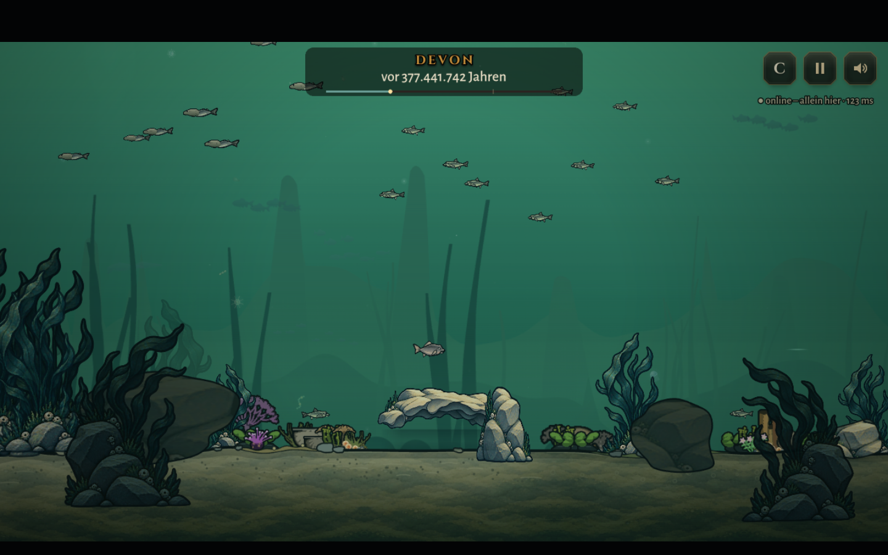
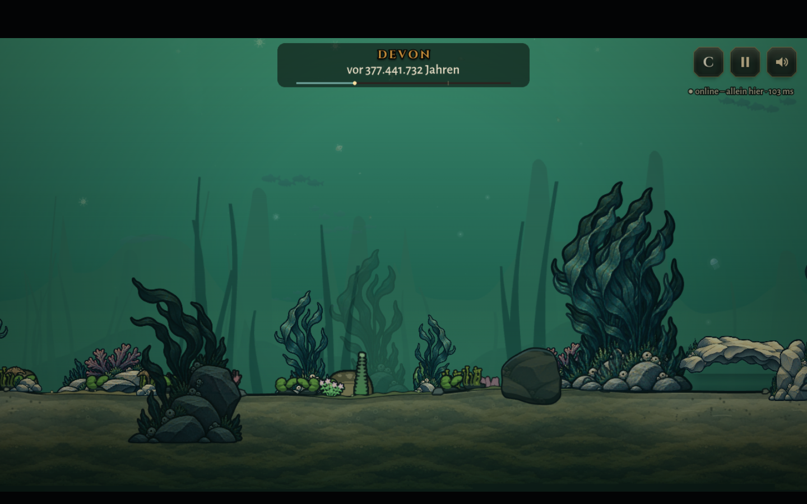

# Gemaltes Devon – erste zusammenhängende Weltfassung

Stilreferenz ist `art/EVO_laich_hoehle_wasser_v1/.../assets/hoehle_vordergrund.png`: warme Sandsteinoberseiten, kühle Schiefer-/Petrolschatten, breite gemalte Flächen und eine kräftige blauschwarze Außenkante. Der Korallengarten dient als Referenz; die wiederverwendbaren Bauteile gelten im Devon auch für Laichfluss und Tiefental.

## Quellen und Einbindung

Die drei Originalbilder in `source/` wurden am 1. November 2026 mit dem Bildgenerierungstool anhand der bestehenden Höhle erzeugt:

- `sandstone.png`: transparentes Blatt mit langem freigestelltem Felsdach und drei getrennten Gruppen von Stützsteinen; ausdrücklich ohne Wasserhintergrund, Säulen am Dach oder Bodenrechteck.
- `reef.png`: drei freigestellte Vignetten aus Bandtang, gedämpftem violettem Schwammbewuchs und Sandstein; dunklere Silhouetten für die kameranahe Ebene, offene Zwischenräume zwischen den Wedeln.
- `sediment.png`: ruhige, kachelbare gemalte Sedimentstruktur in warmem Grauocker und kühlem Schiefer. Keine Gegenstände oder harten Innenkonturen.

`python3 tools/prepare_reef.py` schneidet die getrennten Module zu und verkleinert sie mit erhaltenem Alpha in acht WebP-Dateien (zusammen etwa 596 KiB). Die Originale bleiben erhalten. Die Texturen werden beim Start geladen; die Materialstruktur wird beim Ortsaufbau in die vorhandenen Boden- und Felstexturen gebacken.

`src/art/reefProps.ts` registriert das Dach und seine Stützen an den vorhandenen Felsen. Die Öffnung, festen Körper, Bodenhöhen und Versteckbereiche stammen weiterhin aus dem Weltgenerator. `ReefScenery` setzt weitere Vignetten, lässt Höhlenöffnungen und schmale Durchgänge frei und staffelt gedämpfte Ferne, gemalte Spielebene und dunkle Vordergrundpflanzen. Letztere bewegen sich mit Faktor 1,12–1,18 gegenüber der Kamera, werden außerhalb des Bildes ausgeblendet und werden durchsichtig, wenn der Spieler direkt dahinter schwimmt. Das HUD bleibt darüber.

Auch die übrigen Felsbrocken bekommen gemalte Steinflächen innerhalb ihres vorhandenen Umrisses; die großen Felsen am Schlund erhalten passende Materialstruktur. Ihre Texturgrenzen umfassen nun den tatsächlichen Umriss einschließlich Überstand: Große natürliche Felskuppen werden nicht mehr am Texturrahmen abgeschnitten. Das ist noch keine individuelle Neuzeichnung jedes großen Felsens.

## Fische und Bewegung

Die vorhandenen Fisch-Rigs erhalten eine einmalig gebackene Silhouettenkontur. Körperkanten sind kräftiger als Flossenkanten; Augen und Kiemenüberlagerungen bekommen keinen eigenen äußeren Ring. Die Kontur braucht keinen zusätzlichen Zeichenaufruf. Die Aufhellung des Spielerfisches verwendet acht gecachte Farbstufen und lässt dunkle Tusche unverändert. Die vorhandene Begrenzung unbenutzter Spieleraussehen entfernt auch diese Stufen.

Beim NPC-Biss geht die Pose vom Ausholen über die Rumpfkrümmung zum Vorstoß; Kopf und Flossen behalten ihre vorhandenen Familien-Rigs. Trefferflächen, Reichweite und Netzwerksynchronisierung bleiben bestehen. Die Fernschwärme verwenden zwei vorberechnete, leicht weiche Silhouettenphasen ohne Augen- und Schuppendetails. Sie teilen sich vorhandene Anatomie, haben aber wesentlich weniger Gruppen und geringeren Kontrast. Die eigentlichen Tiere im Spielfeld bleiben erhalten.

## Spielaufnahmen

Der Browservergleich bestätigt 16 → 6 Hintergrundgruppen, identische feste Körper und Durchgänge, unveränderte dunkle Pixel bei der Aufhellung, den tatsächlichen Parallaxefaktor und vollständigen Abbau der zusätzlichen Ebenen beim Szenenwechsel. Der Wechsel der vorberechneten Farbstufen und Schwarmphasen erzeugt keine weiteren Texturen. Die Tierzahl der eigentlichen Simulation bleibt erhalten.

## Prüfen

- `npm run build`
- `npm test -- --maxWorkers=2`
- Vite starten, dann `NODE_PATH=/tmp/evo-browser/node_modules node tools/check_reef.cjs` (externe optionale Abhängigkeit `playwright-core`, Chromium über `CHROMIUM_PATH`). Echte WebGL-Aufnahmen und Prüfbericht in `captures/`.
- `tools/check_fauna.cjs --quick`: gleiche Körper- und Bissgeometrie für 13 Arten, Tönung, Spiegelung, Lebenszyklus und Netzwerkansicht.

`?oldreef` schaltet für den Vergleich die gemalten Weltbauteile, Sedimentstruktur, neuen Fernschwärme und zusätzlichen Fischkonturen ab. Die Korrektur der Spieleraufhellung bleibt aktiv. Die Software-WebGL-Prüfung ist kein Leistungsbenchmark auf einem Mobilgerät oder einer echten GPU. Es entstehen keine neuen Kontur-Zeichenaufrufe und nach Aufbau keine neuen Texturen durch den normalen Ebenen- oder Farbwechsel.

Seit Einführung des Weltbaukastens bleiben im Spielboden verwurzelte Vordergrundpflanzen an derselben Kamerabewegung wie der Boden. Zusätzliche Parallaxe ist dort der separaten nahen Kulisse mit eigenem Bildrand-Untergrund vorbehalten; das behebt abwandernde Fußpunkte.
