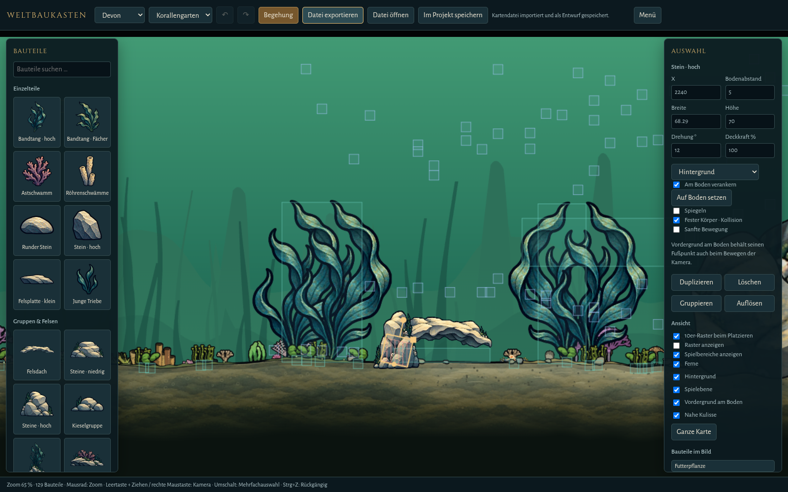

# Weltbaukasten – Spielaufnahmen und Prüfungen

Der Editor ist im Hauptmenü über **Weltbaukasten** erreichbar. Er nutzt dieselben Gelände-, Bauteil- und Schluchtschatten-Renderer wie das Hauptspiel. [Bedienung und Speicherweg](../../src/editor/README.md).

- `captures/browser-check.json`: Menü, Ziehen, Transformationen, Undo/Redo, Browserentwurf, Epochenpalette, Dateirundlauf, abgewiesener Import, Begehung ohne Spielstandänderung und Projektkarte im Hauptspiel.
- `captures/footpoint-check.json`: Auf-den-Boden-Setzen, gleichbleibender Bodenabstand bei numerischer Verschiebung, kamerafeste Fußpunkte und saubere Rückkehr ins Menü.
- `captures/storage-check.json`: aktueller gemeinsamer Stand mit offener Schlucht; Dateirundlauf, Projektspeichern, identischer Tiefenzugang und Kollision eines gedrehten Steinbauteils im Hauptspiel.
- `captures/roundtrip.evo-map.json`: ein echter Testexport, der mit „Datei öffnen“ importiert werden kann. Die Projektregistrierung enthält beim Ausliefern keine automatisch veröffentlichte Testkarte.
- `captures/karbon.png`: Palette und Bauansicht im Karbon.

Die Aufnahmen stammen aus Chromium mit Software-WebGL. Sie prüfen die Darstellung und Bedienung; sie sind kein Leistungsbenchmark einer echten GPU.
